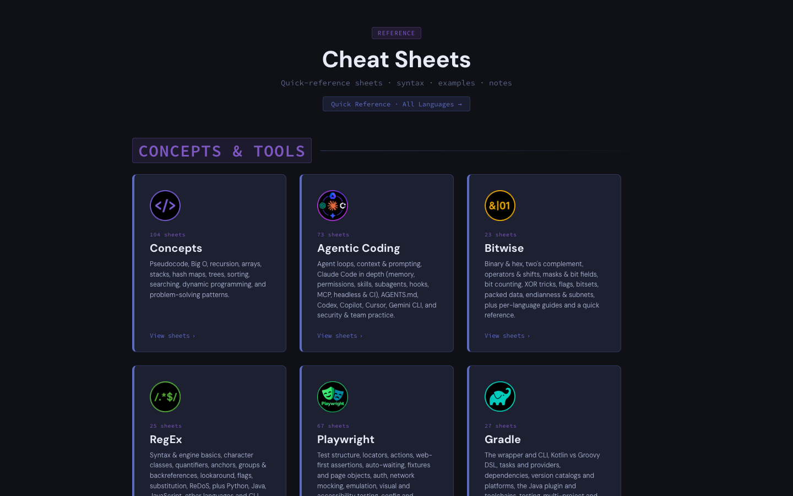
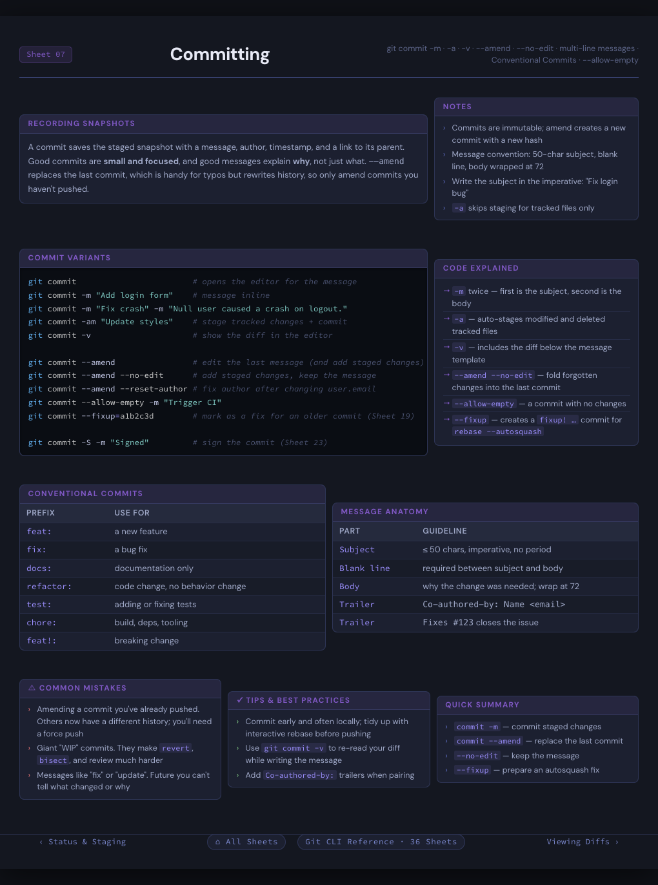
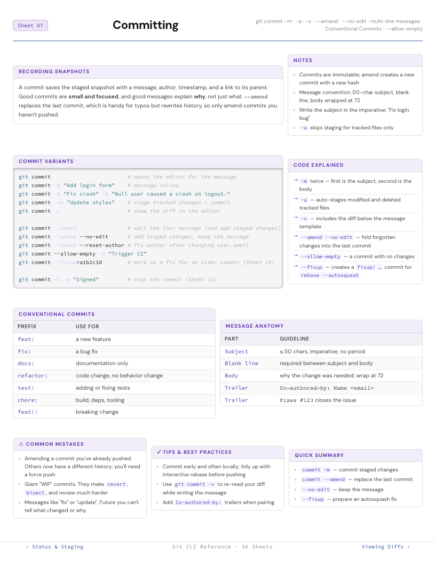
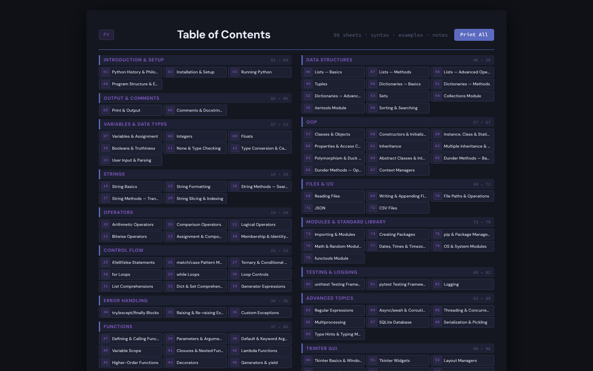
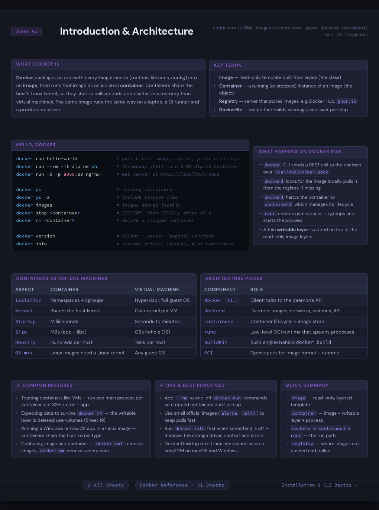
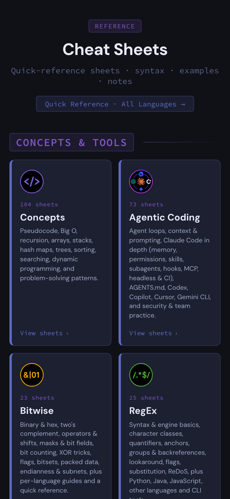

# CheatSheets

A hand-curated collection of single-page reference sheets covering programming languages, CS concepts, and developer tools. Each sheet is designed to print cleanly on a single 8.5" × 11" page and render well in a browser — dark mode by default, light mode at print time.

Built as a personal reference library and a practical exercise in agentic AI-assisted development, HTML/CSS layout, and print-media design.

---

## Screenshots



| A sheet on screen (dark mode) | The same sheet at print time (light mode, 8.5" × 11") |
|---|---|
|  |  |
| **Per-collection table of contents with Print All** | **Another sheet: Docker architecture** |
|  |  |

<p align="center"></p>
<p align="center"><em>Responsive layout on a phone.</em></p>

---

## Purpose

1. **Quick reference** — concise, accurate summaries of languages and concepts used in school and self-study.
2. **Agentic coding practice** — most content is generated by Claude AI from outlines and templates, then verified for accuracy. The project is a testbed for prompt-driven development workflows.
3. **Frontend practice** — hands-on work with HTML, CSS (flexbox, print media, CSS variables, native nesting), and light JavaScript — including responsive and printer-friendly layouts.

---

## Technical Architecture

### Page Format

Each sheet is a standalone HTML file sized to exactly **8.5" × 11"** using CSS variables:

```css
--page-width:  8.5in;
--page-height: 11in;
--margin:      0.5in 0.25in;
```

The layout is a flex column: `header → main → footer`. The `main` height is calculated so content never overflows the page boundary:

```css
--main-height: calc(
  var(--page-height) - 0.2in - (var(--footer-height) + 0.3in)
  - var(--header-height) - var(--header-margin)
);
```

### CSS Architecture

| File | Role |
|---|---|
| `Sheets/CSS/cheatsheet.css` | Shared base — variables, reset, page layout, section styles, tables, code blocks, nav, print rules |
| `Sheets/CSS/[name]-cheatsheet.css` | Per-collection overrides — loaded after the base |

Per-collection CSS uses **native CSS nesting** scoped to per-sheet body IDs (`#s01`, `#s02`, …) to avoid cross-sheet bleed:

```css
#s03 {
  #col-1-1 { flex: 5; }
  #col-1-2 { flex: 4; }
}
```

The layout within each sheet uses **flexbox rows and columns** — `<div class="row">` contains `<div class="col" id="col-N-M">` elements, with flex ratios controlled per sheet in the override CSS.

### Syntax Highlighting

[Prism.js](https://prismjs.com/) is used for code sections that contain pseudocode or real language examples. It is loaded per-sheet on sheets that need it, not globally.

### Per-Collection Structure

Every completed collection follows this file pattern:

```
[lang]-Sheets/
├── manifest.json         # Array of { file, title, desc } — drives the TOC
├── cover.html            # Title page (printed as page 1)
├── index.html            # Table of contents — populated from manifest.json via JS
├── print-all.html        # Aggregator — fetches all pages via DOMParser and triggers window.print()
└── [lang]-01-topic.html  # Individual sheets (01 … N)
```

The `print-all.html` page uses `fetch()` + `DOMParser` to inject all sheet bodies as `.sheet-page` divs, applies `@media print` page breaks, and triggers `window.print()` — producing a multi-page PDF without a backend.

### Theme

- **Dark mode** — default browser view, using a blue-indigo palette (`#0f1117` background, `#5c6bc0` / `#7e57c2` accents)
- **Light / print mode** — `@media print` in `cheatsheet.css` switches to a white background with dark text and hides navigation

---

## Project Structure

```
CheatSheets/
├── index.html                  # Landing page — card grid organized by section
├── Assets/
│   └── Language-Icons/         # PNG icons displayed on landing page cards
├── Sheets/
│   ├── CSS/                    # All stylesheets
│   │   ├── cheatsheet.css      # Shared base (839 lines)
│   │   └── [name]-cheatsheet.css
│   ├── Agentic-Sheets/         # One folder per collection (same structure)
│   ├── Concepts-Sheets/
│   ├── CSS-Sheets/
│   ├── HTML-Sheets/
│   ├── Markdown-Sheets/
│   ├── Mermaid-Sheets/
│   ├── ReGex-Sheets/
│   ├── SQL-Sheets/
│   └── ...
└── DevNotes/
    └── Templates               # Not uploaded to Git
    new collections
```

---

## Workflow

1. **Outline** — a topic list is drafted and refined before any code is written.
2. **Scaffold** — Claude generates the first few sheets using the template CSS and HTML structure. Sheets include a header, a flex layout of rows and columns, and a footer with sheet navigation.
3. **Layout review** — sheets are inspected in Live Server. Column flex ratios, font sizes, and section ordering are adjusted in the per-collection CSS until content fits the page cleanly.
4. **Sheet-by-sheet review** — each sheet is verified for accuracy. Minor tweaks are made directly; larger restructuring (splitting a sheet, adding a row) is delegated to Claude via prompt.
5. **Mobile test** — layouts are verified in a mobile viewport using browser DevTools.
6. **Print-all** — the `print-all.html` page is generated and tested end-to-end in the browser print dialog.
7. **PDF export** — a PDF of the full collection is printed and saved to the repository.
8. **Mark complete** — the collection is checked off in this README.

---

## Collections

✅ Complete · 🚧 In progress · ⬜ Coming soon / planned (outline drafted in the Claude project)

### Concepts & Tools

| Status | Collection | Sheets | Notes |
| :---: | :--- | :---: | :--- |
| ✅ | Concepts | 104 | pseudocode & problem solving, core concepts, paradigms & design, complexity analysis, linear data structures, trees & heaps, graphs, searching & sorting, array & string patterns, recursion & backtracking, dynamic programming, greedy, advanced data structures, math & number theory, string algorithms, quick reference |
| ✅ | Agentic Coding | 73 | introduction & concepts, prompting for code, Claude Code (setup, memory & context, permissions & safety, skills & subagents, hooks, MCP & plugins, automation & headless), instruction files across tools, MCP fundamentals, OpenAI Codex, GitHub Copilot, other agentic tools, quality, security & team practice, quick reference |
| ✅ | Bitwise | 23 | binary, hex & octal, two's complement, AND/OR/XOR/NOT, shifts & rotations, single-bit ops, masks & bit fields, lowest set bit & powers of two, counting & scanning bits, XOR tricks, flags & permissions, bitsets & subsets, colors & packed data, bytes & endianness, IP subnets & CIDR, hashing & branchless tricks, language guides (Python, Java, JS, C/C++, C#, Go, Rust, Kotlin, Ruby, SQL, CLI), quick reference |
| ✅ | RegEx | 25 | flavors, literals & escaping, how the engine matches, character classes & Unicode, quantifiers (greedy, lazy & possessive), anchors & boundaries, groups & backreferences, lookaround, flags, substitution, advanced constructs, performance & ReDoS, Python, Java, JavaScript, other languages, command-line tools, quick reference (validation & text processing) |
| ✅ | Playwright | 67 | introduction & setup, writing tests, locators, actions, assertions, navigation & waiting, fixtures & page objects, authentication, network, browsers, contexts & emulation, visual & accessibility testing, configuration & running tests, debugging & tooling, AI agents & MCP, web app frameworks, language bindings, other runners & cross-language, CI & remote execution, quick reference |
| ✅ | Gradle | 27 | wrapper & project structure, CLI, Kotlin vs Groovy DSL, plugins, tasks, properties & providers, dependencies, repositories & version catalogs, conflicts & platforms, Java plugin & toolchains, application JARs, testing, multi-project & composite builds, convention plugins, build & configuration cache, daemon tuning, custom tasks, publishing, Spring Boot / Kotlin / Android plugins, CI & troubleshooting, quick reference |

### Command Line Interface

| Status | Collection | Sheets | Notes |
| :---: | :--- | :---: | :--- |
| ✅ | Git | 36 | introduction & setup, starting a repository, everyday workflow (staging, committing, diff), history & inspection, branches & tags, merging & rebasing, remotes & collaboration, undoing & recovery (reset, revert, stash, reflog), advanced tools (bisect, worktrees, submodules, LFS, hooks, rewriting history), quick reference |
| ✅ | zsh | 27 | setup & configuration, the command line (ZLE & key bindings), variables & parameters (typeset, expansion flags), arrays, globbing (qualifiers & modifiers), tests, arithmetic & control flow, functions & scripting, interactive customization (prompt & hooks, completion system, plugins & frameworks), quick reference |
| ✅ | Bash | 27 | setup & configuration (startup files, shell options), the command line (output & quoting, redirection & pipes, history, readline & completion), variables & parameters, indexed & associative arrays, globbing & expansion, tests, arithmetic & control flow, functions & scripting (input, getopts, errors & debugging), processes & interactive use, quick reference |
| ✅ | PowerShell | 42 | getting started (editions, cmdlets, profiles), output & comments, variables & types, strings, operators, control flow, the pipeline, error handling, functions, collections, .NET & classes, files & data (JSON, CSV, XML), modules, advanced topics (regex, dates, jobs, REST, debugging), system administration |

### Python

| Status | Collection | Sheets | Notes |
| :---: | :--- | :---: | :--- |
| ✅ | Python | 98 | output & comments, variables & data types, strings, operators, control flow, error handling, functions, data structures, OOP, files & I/O, modules & standard library, testing & logging, advanced topics, Tkinter GUI |
| ✅ | Tkinter | 62 | introduction & setup, windows, classic widgets, layout managers (pack, grid, place), variables & events, menus & dialogs, ttk themed widgets (styles, Notebook, Treeview), Canvas, colors, fonts & images, application patterns (timers, threading, validation, scrollable frames, architecture, DPI, testing, packaging), external libraries (sv-ttk, ttkbootstrap, CustomTkinter, Matplotlib), quick reference |
| ✅ | Django | 70 | Django 6.0: introduction & setup, URLs & routing, views (function & class-based), templates (incl. partials), models, migrations, QuerySets & the ORM, forms, admin, authentication & authorization, middleware, sessions, messages & signals, security (incl. CSP), testing, pagination, caching, email, background tasks, async, logging, i18n, Django REST Framework, deployment |

### Java

| Status | Collection | Sheets | Notes |
| :---: | :--- | :---: | :--- |
| ✅ | Java | 136 | control flow, methods & functions, data structures, OOP, files & I/O, modules & packages, standard library, external libraries, concurrency, database, Swing, JavaFX |
| ✅ | JSP | 34 | directives, implicit objects & scope, Expression Language, standard actions, JSTL (core, fmt, fn), custom tags & TLDs, integration & security |
| ✅ | Spring | 69 | Spring Boot 4.1 / Framework 7: introduction & setup, IoC & dependency injection, configuration & auto-configuration, AOP, Spring MVC REST APIs, Thymeleaf views, HTTP clients, JDBC & schema migrations, Spring Data JPA, Spring Security (JWT, OAuth2), testing, Actuator & observability, events, scheduling, async & virtual threads, caching, resilience, WebFlux, packaging & GraalVM native images |

### JavaScript / TypeScript

| Status | Collection | Sheets | Notes |
| :---: | :--- | :---: | :--- |
| ✅ | JavaScript / TypeScript | 133 | output & comments, variables & data types, strings, operators, control flow, error handling, functions, data structures, OOP, files & I/O, modules & packages, tooling, advanced topics, async, DOM, browser APIs, Node.js, TypeScript fundamentals & type system |
| ✅ | React | 98 | introduction & setup, JSX, components & props, state, events, forms & Actions, refs & effects, context, custom hooks, concurrent features (Suspense, use, transitions, Activity, View Transitions), error handling, performance & React Compiler, TypeScript, styling, React Router, TanStack Query & SWR, Redux Toolkit & Zustand, Server Components & SSR, accessibility, testing, build & deploy, quick reference; every sheet adds Accessibility and Version Notes sections |
| ✅ | React Native | 72 | React Native 0.87 / Expo SDK 57–58: introduction & setup, React refresher, core components, styling & layout, navigation (Expo Router, React Navigation, deep links), platform-specific code & config, data, state & storage, animation & gestures (Reanimated 4, Gesture Handler 3), native code (TurboModules, Fabric, Expo Modules), testing & debugging, EAS build, submit & OTA updates, Apple: iOS, Apple: iPadOS / macOS / tvOS / visionOS, Android, Windows, web & other platforms; every sheet adds iOS and Android sections |

### Web Design

| Status | Collection | Sheets | Notes |
| :---: | :--- | :---: | :--- |
| ✅ | HTML | 56 | introduction & document basics, comments & character references, head & metadata, page structure & semantics, text content, lists, links, images & graphics, audio/video & embeds, tables, forms & validation, details/dialog/popover, accessibility & ARIA, scripting & web components, quick reference; every sheet adds Accessibility and Pairing with CSS sections |
| ✅ | CSS | 77 | introduction & setup, cascade & inheritance (specificity, layers, nesting & @scope), selectors, values, units & functions, custom properties, color (oklch, color-mix, light-dark), box model & sizing, typography, backgrounds & visual effects, layout fundamentals, flexbox, grid, responsive design & print, transforms, transitions & animation (scroll-driven, view transitions), UI & interaction, organization, accessibility & quick reference; every sheet adds Accessibility and Browser Support sections |
| ✅ | CSS Systems | 48 | utility-first (Tailwind, UnoCSS), component frameworks (Bootstrap, Bulma, Foundation), CSS-in-JS (Styled Components, CSS Modules), preprocessors (Sass/SCSS, PostCSS), design tokens & architecture (Open Props, ITCSS), comparisons & migration |
| ✅ | PHP | 133 | introduction & setup, output & comments, variables & data types, strings, operators, control flow, error handling, functions, arrays & data structures, OOP (enums, readonly, property hooks, asymmetric visibility), files & I/O, modules & Composer, standard library, testing & tooling, advanced topics, web fundamentals, PDO, security, quick reference; targets PHP 8.0–8.5 |

### Server & Full-Stack

| Status | Collection | Sheets | Notes |
| :---: | :--- | :---: | :--- |
| ✅ | Node.js | 70 | introduction & setup, modules & packages, event loop & async, process & environment, CLI tools, file system, buffers & streams, networking & HTTP, errors & debugging, testing, concurrency & performance, security, built-in utilities, web frameworks & libraries, deployment |
| ✅ | Vite | 39 | Vite 8: project setup & structure, CLI, config & shared options, aliases, env & modes, TypeScript, dev server & proxy, HMR, dependency pre-bundling, static assets & glob imports, JSON / Wasm / workers, dynamic imports, CSS & preprocessors, Lightning CSS, Tailwind, build & Rolldown chunking, minification, library mode, preview & deployment, browser support, using & writing plugins, SSR, Environment API, JavaScript API, performance, Vitest, troubleshooting, migrating to Vite 8, quick reference |
| ✅ | Next.js | 60 | introduction & setup, routing, server & client components, data fetching, caching & rendering, mutations & server actions, route handlers & proxy, styling, optimizations, authentication & security, data, environment & i18n, testing & debugging, deployment & operations, Pages Router (legacy) |

### SQL & Tools

| Status | Collection | Sheets | Notes |
| :---: | :--- | :---: | :--- |
| ✅ | SQL | 82 | introduction & setup (shared shop schema), which-clause-when and function directory guides, data types, SELECT fundamentals, operators & CASE, built-in functions, aggregation & grouping (ROLLUP, string_agg), joins (semi/anti, LATERAL), subqueries, CTEs & set operations, window functions, DML (upsert, MERGE, bulk load), DDL, database design, views, functions, procedures & triggers, transactions & locking, indexing & query plans, security & backup, JSON, arrays & full-text search, quick reference; every sheet adds Dialect Notes (PostgreSQL, MySQL, SQL Server, SQLite) and an In an ORM box (Prisma first), most add a NoSQL Comparison |
| ✅ | Prisma | 34 | Prisma 7: introduction & setup, schema definition (models, relations, enums, indexes), CRUD, filtering & pagination, relations & nested writes, aggregations, transactions, migrations, error handling, performance & pooling, soft deletes & auditing, $extends, TypeScript types, testing, debugging & Studio, raw SQL, special types, self-relations, validation, best practices, security, migration strategies |

### Markup & Notation

| Status | Collection | Sheets | Notes |
| :---: | :--- | :---: | :--- |
| ✅ | Markdown | 22 | flavors (CommonMark, GFM, Pandoc, Obsidian), paragraphs, line breaks & escaping, text formatting, headings & anchors, unordered & ordered lists, nested, task & definition lists, blockquotes, callouts & rules, links, images, inline code & code blocks, syntax highlighting & Mermaid diagrams, table basics & alignment, complex tables, footnotes & math, front matter & attributes, raw HTML & collapsible sections, GitHub Markdown & READMEs, Obsidian & chat-app Markdown, tooling (Pandoc, linters & site generators), best practices & pitfalls, quick reference (core & extended) |
| ✅ | Mermaid | 46 | Mermaid 12, one sheet per diagram type with live rendered output: where Mermaid runs, diagram anatomy & front matter, rendering & tooling (JS API, mmdc), choosing a diagram type, flowcharts (shapes, links, subgraphs), sequence (messages, activations, control blocks), ER (attributes, cardinality), state (composite, choice, concurrency), class (members, relationships), Gantt & timeline, mindmaps, Git graphs, themes, looks & config, styling & theme variables, process & behavior (swimlanes, user journey, use case, requirement, ZenUML, event modeling), charts (pie, quadrant, XY, Sankey, radar, treemap, Venn), architecture (C4, architecture, block, packet, tree view), planning (Kanban, Ishikawa, Wardley map, Cynefin), quick reference |
| ✅ | JSON | 15 | Values & Data Types, Objects & Arrays, JSON Schema, Parsing & Serialization, JSONPath & Querying, JSON in APIs & HTTP, Advanced & Related Formats, JSON Schema in Practice, Typed Validation (Zod, Pydantic), OpenAPI & JSON Bodies, JSON Patch & Merge Patch, Gotchas & Interop, quick reference |
| ✅ | XML | 16 | Elements & Attributes, Text, Data & Special Characters, Namespaces, DTD, XML Schema (XSD), XPath, XSLT, Parsing XML, Practical XML, XML Security, XSLT Variables, Keys & Grouping, XPath 2.0/3.1 & XQuery, XML Formats in the Wild, quick reference |
| ✅ | YAML | 14 | Scalars & Data Types, Collections — Sequences & Mappings, String Styles & Multiline, Anchors, Aliases & Merges, Schema, Tags & Directives, Real-World YAML Patterns, Tooling, Validation & Language Integration, Type Gotchas & Quoting, Templating & Config Layering, yq, Editor Schemas & CI Linting, quick reference |

### C Family

| Status | Collection | Sheets | Notes |
| :---: | :--- | :---: | :--- |
| ✅ | C | 98 | C17 with C23 tags: introduction & toolchain, output & comments, variables & data types, strings, operators, control flow, error handling (return codes, errno), functions, pointers, memory management, arrays & data structures, structs, unions & enums, files & I/O, preprocessor, headers & builds (Make, CMake), standard library, tools & libraries, advanced topics (UB, threads, atomics, signals, C23), quick reference |
| ✅ | C++ | 125 | C++23 with C++26 notes: introduction & setup, I/O & comments, variables & data types, strings, operators, control flow, error handling (exceptions, optional, expected), functions & lambdas, STL containers, OOP (copy & move semantics), files & I/O, headers & modules, external libraries, concurrency & coroutines, pointers & references, memory management & smart pointers, templates & concepts, iterators, algorithms & ranges |
| ✅ | C# | 130 | C# 14 / .NET 10 with C# 15 preview notes: introduction & setup, output, input & comments, variables & data types (nullability), strings, operators, control flow & pattern matching, error handling, methods, delegates & events, collections, OOP (records, structs, generics), files & I/O, namespaces, NuGet & BCL, testing & logging, async/await, threading & performance, LINQ, Entity Framework Core |

### Languages

| Status | Collection | Sheets | Notes |
| :---: | :--- | :---: | :--- |
| ✅ | Go | 112 | Go 1.27: introduction & toolchain, output & comments, variables & data types, strings, operators & pointers, control flow, errors as values, functions, data structures & iterators, types, methods, interfaces & generics, files & I/O, modules & standard library, external libraries, advanced topics, concurrency, testing & tooling, web & networking, quick reference |
| ✅ | Ruby | 115 | Ruby 4.0: introduction & setup, output & comments, variables & data types, strings, operators, control flow & pattern matching, error handling, methods & blocks (procs, lambdas, closures), data structures, OOP & modules, files & I/O, gems & Bundler, testing & tooling, advanced topics (regex, threads, fibers, Ractors, RBS), Enumerable & enumerators, metaprogramming |

### DevOps & Containers

| Status | Collection | Sheets | Notes |
| :---: | :--- | :---: | :--- |
| ✅ | Docker | 31 | installation & CLI, contexts, Docker Desktop, running containers & lifecycle, logs & debugging, resource limits, images, tags & registries, Dockerfile, build & BuildKit, multi-stage builds & caching, Buildx multi-platform builds, volumes & bind mounts, networking, Compose (services, volumes, networks, secrets, workflows), Swarm (nodes, services, stacks), cleanup & troubleshooting, security & best practices, quick reference |
| ✅ | Kubernetes | 25 | local clusters & kubectl, kubeconfig & contexts, inspecting resources, imperative vs declarative, manifests & labels, Pods, Deployments & rollouts, StatefulSets & DaemonSets, Jobs & CronJobs, probes & Pod lifecycle, Services & DNS, Ingress & Gateway API, network policies, ConfigMaps & Secrets, volumes & storage, requests, limits & quotas, scheduling, autoscaling & disruption budgets, RBAC, Pod Security, debugging, Helm & Kustomize, quick reference |
